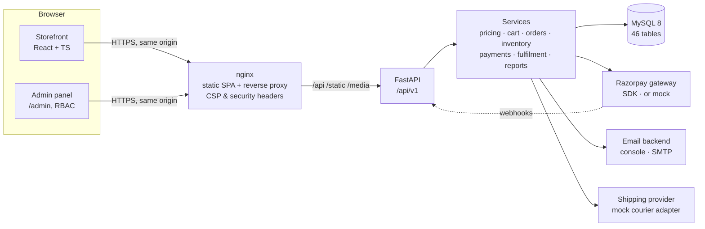
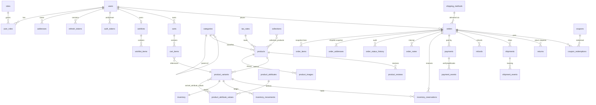
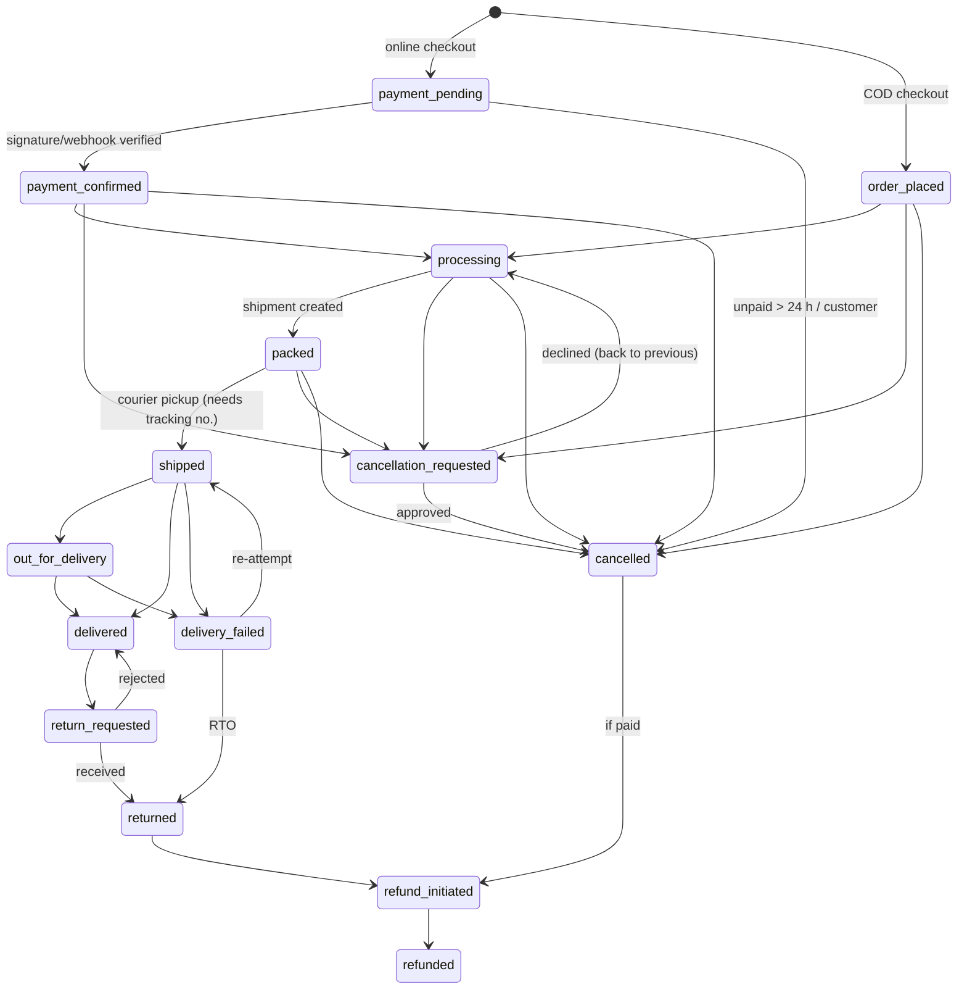
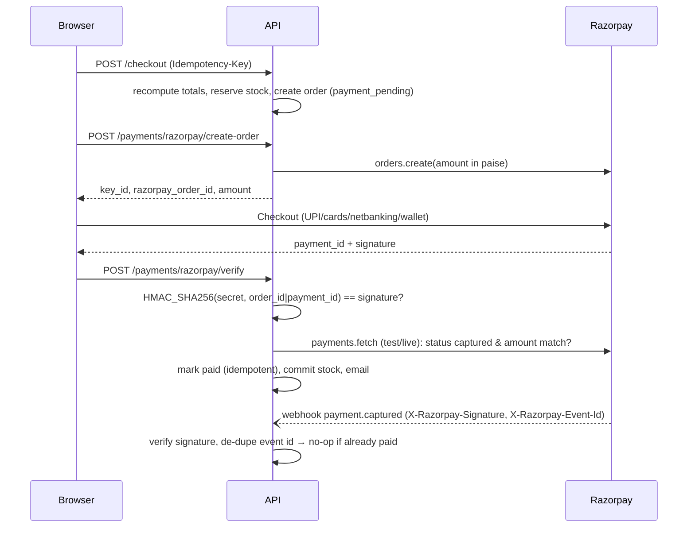

# Architecture

## System overview

**Layers (backend)**

| Layer | Responsibility |
|---|---|
| `api/v1/*` | HTTP only: validation (Pydantic), auth dependencies, status codes, serialisation. No business rules. |
| `services/*` | All business logic and transactions: pricing engine, cart, checkout, order state machine, inventory reservations, payments/refunds, fulfilment, reports, invoices. |
| `integrations/*` | Adapters behind small protocols: `PaymentGateway` (Razorpay SDK / mock), `EmailBackend` (console / SMTP), `ShippingProvider` (mock courier; plug in Shiprocket/Delhivery). |
| `models/*` | SQLAlchemy 2 typed models; constraints in the database, not only in code. |
| `core/*` | Settings (env only), DB engine, Argon2/JWT, RBAC deps, structured errors, rate limiting, money helpers, redacting logger. |

**Frontend** — `services/` (typed API client with silent token refresh), `features/` (auth, cart, wishlist, payments, toast state),
`components/ui` (design system: buttons, fields, modal, drawer, price, badges, pagination…), `components/layout|product|forms`,
`pages/` (storefront, account, auth) and `pages/admin` (lazy-loaded admin app). Server state lives in TanStack Query; forms use
React Hook Form + Zod mirroring backend rules.

## Database relationships

Also: `promotions`, `banners`, `cms_pages`, `store_settings`, `serviceable_pin_codes`, `newsletter_subscribers`, `notifications`, `audit_logs`.

Key rules enforced by the schema:
- `products.sku`, `product_variants.sku`, `orders.order_number`, `orders.idempotency_key`, `payments.razorpay_order_id`,
  `payments.razorpay_payment_id`, `refunds.razorpay_refund_id`, `refunds.idempotency_key`, `payment_events.event_id` are **UNIQUE**.
- Money is `DECIMAL(12,2)` (rupees). Gateway amounts are `BIGINT` paise.
- CHECK constraints: `sale_price ≤ mrp`, `mrp > 0`, `quantity_on_hand ≥ 0`, `quantity_reserved ≥ 0`, review rating 1–5, positive quantities.
- `order_items` and `order_addresses` snapshot name, SKU, image, attributes, prices, discounts, tax and HSN at purchase time; FKs to
  products/variants are `ON DELETE SET NULL`, so history survives catalogue changes. Products referenced by orders are archived, not deleted.

## Money conversion strategy

- All arithmetic uses `decimal.Decimal`, quantised to 0.01 with `ROUND_HALF_UP` (`app/core/money.py`). Floats are never used.
- `paise = int((rupees × 100).quantize(1, ROUND_HALF_UP))`; `rupees = paise / 100` quantised to 0.01.
- The API serialises money as strings (`"499.00"`); the frontend only formats them.
- Discounts are allocated across lines proportionally; the rounding remainder goes to the largest line, so lines always sum exactly to the total.

## Pricing engine

`app/services/pricing.py` is pure (no DB) and fully unit-tested. Order of application:

1. **Item price** — the variant's sale price, or its scheduled sale price while its window is active.
2. **Automatic promotions** — ascending `priority`. Types: `percent_off`, `fixed_off`, `bogo` (cheapest eligible units discounted),
   `quantity_discount` (N+ units), `free_shipping`. Each discounts the current net of its eligible lines (all / categories incl.
   sub-categories / products). If a promotion that actually applies is **non-stackable**, later item promotions are skipped.
   Free-shipping promotions only affect shipping.
3. **Coupon** — at most one. Validated for active window, total usage limit, per-customer limit, customer allow-list, first-order-only,
   minimum cart value and eligibility. Percent coupons honour `max_discount`; fixed coupons never exceed the eligible amount.
   If the coupon isn't combinable with promotions (coupon flag or store setting `allow_coupon_with_promotions`), the engine keeps the
   **better deal for the customer** and explains it.
4. **Shipping** — free when the post-discount merchandise total ≥ the method's threshold (or store default ₹999), or via a free-shipping
   coupon/promotion; otherwise the method's charge.
5. **COD fee** — flat fee (₹49 default) when paying cash on delivery; COD also requires a COD-enabled PIN, method and products and an order ≤ the COD limit.
6. **GST** — prices are tax-inclusive (Indian MRP convention); the GST component of each line's net amount is computed and shown, never added on top.

The browser never sends totals; `/checkout/validate` and `/checkout` always recompute from the database.

## Order state machine

`order_service.transition()` rejects any edge not in the table (`409 invalid_transition`) and enforces guards: `processing` requires a paid
or COD order; `shipped` requires a shipment with a tracking number; `refund_initiated` requires a captured payment. Admins may set only
operational statuses directly (processing, packed, out for delivery, delivered, delivery failed); cancellations, returns, refunds and payment
states go through dedicated flows that also move stock, coupons and money. Every change writes `order_status_history`; admin actions also write
`audit_logs`. Customers can cancel up to *processing*; a *packed* order becomes a cancellation request.

## Inventory & reservations

- `available = quantity_on_hand − quantity_reserved` per variant.
- **Checkout** locks the affected inventory rows with `SELECT … FOR UPDATE` in ascending variant-id order (prevents deadlocks), checks
  availability, increments `quantity_reserved` and writes `inventory_reservations` with a 15-minute expiry — all in the order's transaction.
- **Payment captured / COD placed** → reservation committed: on-hand and reserved both decrease; a `sale` movement records the balance.
- **Payment failed or hold expired** → reservation released; the order stays payable and **re-reserves** on retry. Unpaid orders close after 24 h.
- **Late payment** after release re-reserves if stock remains, otherwise the order is cancelled and refunded automatically.
- **Cancellation after commit / accepted return** → stock restocked with a `cancellation` / `return` movement.
- Admin adjustments can't go below reserved stock. A real MySQL test fires 12 concurrent reservations at 5 units: exactly 5 succeed.
- The sweeper runs every 60 s inside each API process (safe to run concurrently — it locks rows); also triggerable from the admin panel.

## Payments

- **Idempotency**: checkout keyed by `Idempotency-Key` (per user); one `payments` row per Razorpay order; `payment_events.event_id`
  UNIQUE (`X-Razorpay-Event-Id` or `verify:<payment_id>`); `mark_paid` is a no-op on captured payments; duplicate payments for an
  already-paid order are refunded without touching the order's state; refunds use idempotency keys forwarded to Razorpay.
- **Retries**: an unpaid order can be paid again from the result page or order page; a fresh hold is taken.
- **Refunds**: full on paid cancellations, partial for returns/admin goodwill (never above the refundable remainder); webhook `refund.processed/failed` updates status.
- **Mock mode** (`RAZORPAY_MODE=mock`) generates ids and real HMAC signatures with your configured secrets; the endpoint
  `/payments/razorpay/mock-checkout` exists only in mock mode.
- Stored: Razorpay order/payment/refund ids, amounts in paise, currency, status, method, error code/description, timestamps. Never stored:
  card numbers, CVV, UPI PIN, VPA or contacts (webhook payloads are sanitised before saving).

## Authentication & security

- Argon2id password hashing (auto-rehash on login). JWT access tokens (15 min) held in memory by the SPA.
- Refresh tokens: opaque, SHA-256-hashed in DB, HttpOnly + SameSite cookie scoped to `/api/v1/auth`, rotated on every refresh;
  **reuse of a rotated token revokes the whole session family**. Refresh/logout require a double-submit CSRF header.
- Email verification and password-reset tokens are single-use, hashed, and expire (48 h / 1 h). Reset logs out all sessions.
  "Forgot password" responses don't reveal whether an account exists.
- RBAC: roles carry permission lists (`admin` = `*`; `staff` = operations). Checked on every admin endpoint; finance metrics,
  cost prices, refunds, coupon/shipping writes, settings and the audit log are admin-only by default.
- Rate limits on login, register, password reset, checkout, payments, coupons, guest order lookup (in-process; swap for Redis when scaling out).
- Uploads: MIME + magic-byte sniffing, 5 MB cap, random server-side filenames. CSV import size-capped and validated row by row.
- Guest order access uses an HMAC capability key, not sequential ids.
- Logs pass through a redaction filter (passwords, tokens, signatures, `?key=` params, long digit runs).
- Production start-up refuses insecure settings (dev secret key, insecure cookies, mock payments).

## Search

Products carry a denormalised, lower-cased `search_text` (name, SKU, brand, categories, tags, attribute values). Queries are tokenised,
stemmed and expanded with Indian-vernacular synonyms (jhumki → jhumka/earring, kada → bangle, sari → saree, payal → anklet…). When nothing
matches, a fuzzy "Did you mean" suggestion is computed from the catalogue vocabulary. For large catalogues, add a MySQL FULLTEXT index
or an external engine behind `catalog_service`.

## Reports — metric definitions

See the module docstring of `app/services/report_service.py` (also returned by the API and shown in the admin UI):
counted orders exclude unpaid/abandoned and cancelled COD orders; **Net sales = Gross sales − Discounts − Refunds**; **Revenue** is what
customers were charged incl. shipping/COD fees; AOV = Revenue ÷ counted orders; gross margin uses snapshotted unit cost (admins only).
